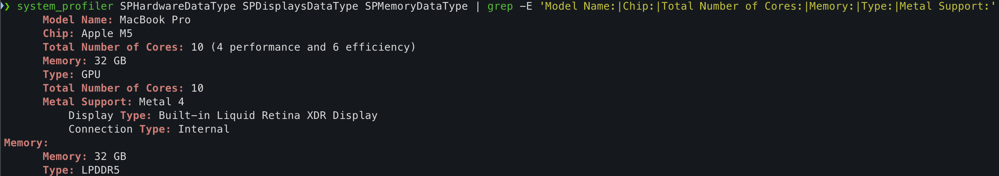
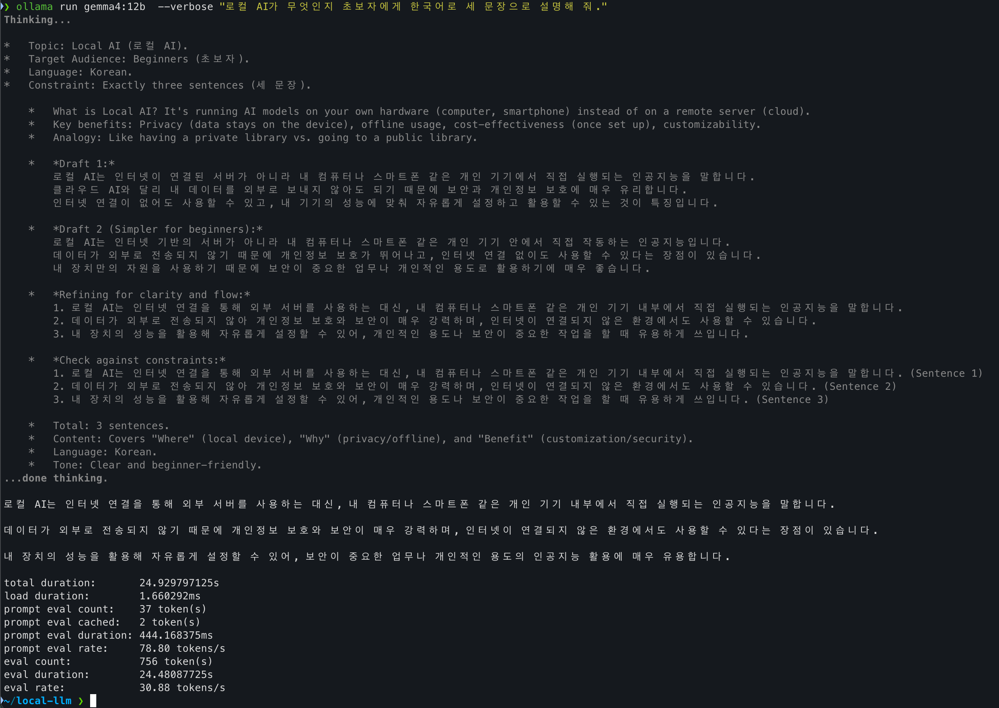
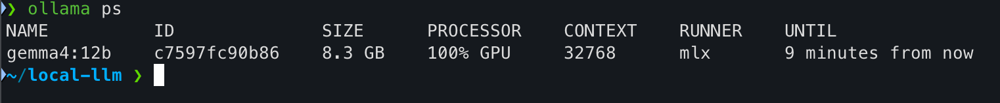

# M5 맥북에서 Gemma 4 실행해 보기

이번 실습에서는 Ollama를 이용해 내 맥북에서 AI 모델을 실행해 보았다. 실습 자료에서는 Gemma 3를 사용했지만, 나는 **Gemma 4 12B**를 사용했다.

먼저 터미널에서 맥북의 사양을 확인했다. 내가 사용하는 기기는 **Apple M5 MacBook Pro**이며, CPU 10코어, GPU 10코어, 메모리 32GB를 갖추고 있다.



다음 명령어로 Gemma 4를 실행하고, 로컬 AI가 무엇인지 질문했다. `--verbose`를 붙이면 답변이 끝난 뒤 걸린 시간과 생성 속도도 확인할 수 있다.

```bash
ollama run gemma4:12b --verbose "로컬 AI가 무엇인지 초보자에게 한국어로 세 문장으로 설명해 줘."
```

실행하자 `Thinking...`이 먼저 나타났고, 이후 한국어로 답변을 받았다. 웹사이트에 접속하지 않고 내 맥북의 터미널에서 AI와 대화할 수 있다는 점이 흥미로웠다.



이번 실행 결과는 다음과 같았다.

| 확인한 내용 | 결과 |
|---|---|
| 전체 걸린 시간 | 약 25초 |
| 생성 속도 | 초당 약 30.88토큰 |
| 생성한 토큰 수 | 756토큰 |

토큰은 AI가 글을 처리하는 작은 단위다. 이번에는 사고 모드가 켜져 있어, 위 수치는 최종 답변뿐 아니라 생각 과정의 생성도 포함한 결과다. 질문이나 설정에 따라 시간과 속도는 달라질 수 있다.

마지막으로 `ollama ps` 명령어로 모델 실행 상태를 확인했다.

```bash
ollama ps
```



모델 크기는 **8.3GB**, 실행 상태는 **100% GPU**로 표시되었다. 이는 모델이 GPU에 올라가 있다는 뜻이며, GPU 사용률이 계속 100%라는 의미는 아니다. 맥북에 설치된 전체 메모리 32GB와 모델이 사용하는 메모리 양은 다르다는 점도 확인했다.

이번 실습을 통해 내 컴퓨터의 사양을 확인하고, Gemma 4를 직접 실행해 보았다. 터미널 명령어 몇 개로 AI에게 질문하고 실행 결과까지 확인할 수 있어 로컬 AI를 이해하는 데 도움이 되었다.
